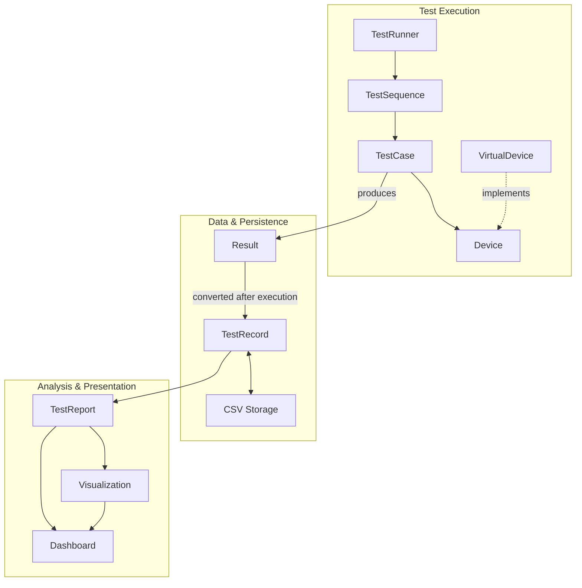

# Hybrid Reliability Lab

A Python-based hardware test automation platform that simulates an end-to-end hardware reliability testing workflow. It
uses a device abstraction and VirtualDevice to support test development without requiring physical hardware, while keeping
the test framework decoupled from specific device implementations. The workflow covers test execution, data collection,
persistence, analysis, reporting, and visualization.

## Key Features

- **Automated Test Execution** — Executes ordered test sequences through a structured test lifecycle and collects completed test results.
- **Device Abstraction and Virtual Hardware Simulation** — Decouples test logic from specific device implementations and enables test software development without requiring physical hardware.
- **Deterministic Failure Simulation** — Injects controlled device failures to verify error handling and reliability behavior through reproducible test scenarios.
- **Structured Test Data** — Represents completed test results in a consistent data model for downstream persistence, reporting, and analysis.
- **CSV Persistence** — Persists completed test records to CSV and restores stored history for downstream processing.
- **Reporting and Visualization** — Summarizes completed test data into report statistics and visualizes test outcomes and measurement results.
- **Interactive Dashboard** — Presents test summaries, visualizations, failure information, and filterable test history through a Streamlit-based interface.

## Architecture



The architecture separates test execution, data persistence, and analysis/presentation responsibilities. Test execution
depends on the `Device` abstraction rather than a specific hardware implementation, allowing `VirtualDevice` to provide
deterministic simulated behavior during development. Completed execution results are converted into persistent test
records that can later be restored for reporting, visualization, and dashboard presentation.

## Test Execution Flow

`main.py` assembles the device, test cases, test sequence, and runner before starting execution. `TestRunner` manages the
device connection lifecycle and delegates ordered test execution to `TestSequence`. Each `TestCase` performs its device
operations, evaluates the collected measurement, performs cleanup, and produces a `Result`.

Completed results are collected by `TestSequence` and returned through `TestRunner` to the application orchestration
layer. If a test encounters an execution or cleanup failure, its completed error evidence is preserved and the remaining
test sequence is stopped.

## Data Pipeline

Completed `Result` objects are converted by `Logger` into immutable `OneTestRecord` objects, which provide a consistent
data representation for persistence and downstream analysis. The records can be exported to CSV for persistent storage
and can also be passed directly to `ReportGenerator` during the current execution to produce an aggregated
`OneTestReport`.

Persisted CSV history can later be restored through `CSVReader`, which reconstructs typed `OneTestRecord` objects before
they are used by reporting or presentation components. This keeps downstream processing based on the application's data
model instead of raw CSV rows.

## Reliability and Failure Handling

The test framework distinguishes between normal test outcomes and execution failures. `PASS` and `FAIL` represent
completed test evaluations and allow the sequence to continue, while execution or cleanup failures are treated as
reliability events that require additional handling.

| Scenario | Result Behavior | Sequence Behavior |
| --- | --- | --- |
| PASS / FAIL | A completed `Result` is preserved | Continue to the next test |
| Device operation failure | Preserve an `ERROR` result with the primary error | Stop the remaining sequence |
| Cleanup failure after PASS / FAIL | Preserve the original outcome and record `cleanup_error` separately | Stop the remaining sequence |
| Operation failure + cleanup failure | Preserve the primary execution error and secondary cleanup error | Stop the remaining sequence |
| Connection / startup failure | No completed `Result` or `TestRecord` is created | Propagate the failure to the caller |

`ExecutionError` is used to transfer completed failure evidence from a `TestCase` to `TestSequence`. The sequence preserves
the failed test result together with any previously completed results, then stops further execution because the device
state may no longer be reliable.

## Device Abstraction and Virtual Hardware

Test cases interact with the device through a common `Device` abstraction rather than depending on a specific hardware
implementation. This keeps test execution logic separate from device-specific behavior and provides a path for replacing
the simulated device with real hardware integrations in the future.

`VirtualDevice` provides deterministic simulated behavior for development and automated testing without requiring
physical hardware. In addition to normal device operations, it supports controlled connection, movement, read, and cleanup
failures so that reliability and error-handling paths can be reproduced and verified consistently.

VirtualDevice-specific failure controls remain outside the common `Device` contract, preventing simulation-only behavior
from becoming a requirement for future real-device implementations.

## Installation

This project has been tested with Python 3.11.

Clone the repository and create a virtual environment:

```bash
python3.11 -m venv venv
source venv/bin/activate
```

Install the project dependencies:

```bash
python -m pip install --upgrade pip
pip install -r requirements.txt
```

## Running the Test Workflow

Run the end-to-end test workflow from the project root:

```bash
python main.py
```

The application executes the configured test sequence, collects completed results, converts them into test records,
persists the records to CSV, and generates an aggregated test report.

Generated CSV output is written under:

```text
output/
```

## Running Tests

Run the automated test suite from the project root:

```bash
python -m pytest
```

The current MVP includes unit, integration, and end-to-end coverage across test execution, virtual-device behavior,
reliability handling, persistence, reporting, visualization, and dashboard helper logic.

## Running the Dashboard

Start the Streamlit dashboard from the project root:

```bash
PYTHONPATH=. streamlit run src/dashboard/dashboard.py
```

The dashboard presents test summary metrics, outcome and measurement visualizations, failure information, and filterable
test history.

## Project Structure

```text
hybrid-reliability-lab/
├── main.py                 # MVP orchestration entry point
├── src/
│   ├── controller/         # Test execution lifecycle management
│   ├── framework/          # Test cases, sequences, results, and execution errors
│   ├── device/             # Device abstraction and real/virtual implementations
│   ├── communication/      # Real-device communication boundary
│   ├── hardware/           # Real-device hardware operations
│   ├── sensors/            # Real-device measurement interface
│   ├── data/               # Persistent test-record model and CSV restoration
│   ├── logger/             # Result-to-TestRecord conversion
│   ├── export/             # CSV persistence
│   ├── report/             # Aggregated test reporting
│   ├── visualization/      # Report visualization
│   └── dashboard/          # Streamlit dashboard
├── tests/                  # Unit, integration, and end-to-end tests
├── docs/                   # Architecture, design decisions, testing strategy, and project journal
├── requirements.txt        # Python dependencies
└── README.md
```

## Example Test Output

A normal execution with the configured virtual device produces structured test records such as:

```text
TestCase1
  Measurement: 25
  Outcome: PASS
  Error: None
  Cleanup Error: None

TestCase2
  Measurement: None
  Outcome: PASS
  Error: None
  Cleanup Error: None
```

The complete persisted CSV record also includes a unique test ID, start and end timestamps, execution duration,
measurement, outcome, primary error information, and cleanup error information.

Reliability scenarios such as device-operation failures and cleanup failures are covered by the automated test suite,
where error evidence is preserved and propagated through the execution and persistence pipeline.

## Engineering Decisions

Several design choices were made to keep the test platform modular, testable, and suitable for future hardware integration:

- **Separate the test framework from device implementations** — Test cases depend on the `Device` abstraction rather than
  directly on `VirtualDevice` or device-specific components, allowing different device implementations to be introduced
  without changing the test framework.

- **Keep execution results separate from persistent test records** — `Result` represents execution-layer state, while
  `OneTestRecord` represents completed test data used for persistence, reporting, and downstream processing.

- **Preserve failure evidence before stopping execution** — Test-level execution failures are transferred through
  `ExecutionError`, allowing `TestSequence` to retain the completed error result before stopping the remaining sequence.

- **Separate cleanup failures from primary execution failures** — Cleanup errors are stored independently so that a
  cleanup failure does not overwrite the original test outcome or primary execution error.

- **Restore persisted data into typed application models** — CSV history is reconstructed as `OneTestRecord` objects
  before downstream processing, keeping reporting and presentation logic independent from raw serialized CSV rows.

- **Keep deterministic failure injection specific to `VirtualDevice`** — Simulation-only controls remain outside the
  common `Device` contract so future device implementations are not required to support artificial failure behavior.

## Documentation

Additional engineering documentation is available in the `docs/` directory:

- [`architecture.md`](docs/architecture.md) — System responsibilities, component relationships, and execution/data flow.
- [`design_decisions.md`](docs/design_decisions.md) — Detailed architectural and implementation decisions made during development.
- [`testing_strategy.md`](docs/testing_strategy.md) — Testing approach and coverage strategy.
- [`project_journal.md`](docs/project_journal.md) — Incremental development history and daily engineering progress.
- [`roadmap.md`](docs/roadmap.md) — MVP development roadmap and completed milestones.
