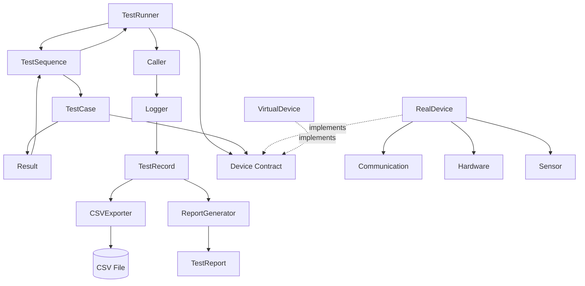
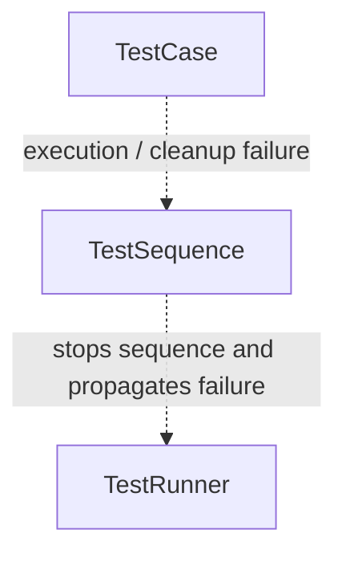

# System Architecture

---
## Objective

Build a Python-based hardware testing platform.

The system simulates an automated testing laboratory capable of:

- Controlling hardware devices
- Collecting sensor data
- Logging test results
- Performing data analysis
- Generating reports

## Core Modules

- Framework
- Controller
- Device
- Hardware
- Sensors
- Communication
- Data
- Logger
- Export
- Report
- Analysis
- Dashboard

## Core Responsibilities  

**TestRunner**: Manages the overall test execution lifecycle.
1. Connects to device before test execution
2. Starts test sequence
3. Ensures the device is disconnect after execution
4. Returns the collected execution results to the caller

**TestSequence**: Defines and executes the test sequence  
1. Runs the individual tests in order
2. Collects and returns test results for the current execution
3. Stops the remaining sequence when an execution-level failure propagates from a test case

**TestCase**: Defines and executes the logic of an individual test
1. Defines and performs the steps of an individual test
2. Collects measurements and determines the test outcome (`PASS`, `FAIL`, or `ERROR`)
3. Stores the test outcome and execution information in a `Result` 
4. Performs case-level cleanup after test execution
5. Raises `ExecutionError` when an execution-level failure requires the test sequence to stop

**Device**: Defines the abstract contract that all device implementations must follow
1. Defines the minimum set of operations required by the test framework
2. Enforces that concrete device implementations provide the required methods

**RealDevice**: Implements the Device contract using the real hardware components
1. Receives Communication, Hardware, and Sensor dependencies during initialization
2. Implements the operations defined by the Device abstraction
3. Delegates device operations to the appropriate underlying component

**VirtualDevice**: Implements the Device contract using simulated device state and behavior
1. Maintains simulated connection, movement, and measurement state
2. Implements the same operations defined by the Device abstraction
3. Provides VirtualDevice-specific controls for configuring deterministic measurement and failure scenarios 
4. Keeps simulation-specific controls outside the Device contract
5. Raises `DeviceError` for invalid device operations and simulated device failures

**Result**: Stores the outcome and execution information of an individual test
1. Stores the test outcome (`PASS`, `FAIL`, or `ERROR`)
2. Stores measurement, timing information, and name of the test 
3. Preserves test-level error information when test execution fails

**TestRecord**: Represents the completed data of an individual test execution
1. Stores test name, measurement, timing, outcome, and error information
2. Assigns a unique identifier to each recorded test execution
3. Preserves completed test data as an immutable record
4. Provides a data-layer representation independent from the execution-layer `Result`

**Logger**: Records completed test result data outside the test execution framework
1. Receives completed `Result` objects after framework execution
2. Converts each completed `Result` into an independent `TestRecord`
3. Collects recorded test executions for downstream data processing
4. Keeps logging responsibilities separate from TestRunner, TestSequence, and TestCase

**CSVExporter**: Persists completed test records in CSV format
1. Receives completed `TestRecord` objects for export
2. Serializes record fields into a stable CSV representation
3. Appends new records without replacing previously exported test data
4. Writes the CSV header only when the target file does not exist or is empty
5. Preserves the input record order during export
6. Performs no file operation when no records are provided

**ReportGenerator**: Generates structured test summaries from completed test record data
1. Receives completed `TestRecord` objects for report generation
2. Aggregates test outcomes into total, pass, fail, and error counts
3. Calculates the pass rate when test records are available
4. Calculates measurement count, minimum, maximum, and average from available measurement values
5. Excludes missing measurements from measurement statistics while preserving valid zero values
6. Collects relevant failure information from `FAIL` and `ERROR` records
7. Rejects records with unsupported test outcomes
8. Produces a `TestReport` without modifying the source test records

**TestReport**: Represents aggregated report data derived from completed test records
1. Stores total test, pass, fail, and error counts
2. Stores the calculated pass rate, or no pass rate when no tests are available
3. Stores measurement count, minimum, maximum, and average statistics
4. Represents unavailable measurement statistics explicitly when no valid measurements exist
5. Stores summarized failure details for `FAIL` and `ERROR` test records
6. Contains report data only and performs no report calculation

**ExecutionError**: Represents an execution-level failure that must be propagated through the framework 
1. Preserves the original exception together with test context. 
2. Carries the associated result, failure stage, and timestamp. 
3. Preserves a secondary cleanup error when both execution and cleanup fail. 
4. Propagates the failure upward so the remaining test sequence can be stopped.

**DeviceError**: Raises DeviceError for invalid device operations and simulated device failures
1. Belongs to the Device abstraction layer
2. Can be raised by concrete device implementations when an operation is invalid or cannot be completed
3. Keeps device-level failures independent from framework-level `ExecutionError`

## Core Execution and Data Flow

The following diagram shows the direct interactions and data flow between the core components during and after test
execution.

Solid arrows represent direct runtime interaction or data flow between components.
Dashed arrows represent implementation of an abstraction contract.

Each TestCase produces a Result for its execution. TestSequence collects the Results produced during the current
execution and returns them through TestRunner to the caller. Execution results are scoped to a single run and are not
stored as persistent state in TestSequence. The caller can pass completed Results to the Logger after execution, keeping
result logging outside the test execution framework. The Logger converts each completed Result into an immutable
TestRecord with its own record identity, providing a data-layer representation for downstream data processing.

Completed TestRecord data can be consumed independently by downstream components. CSVExporter persists TestRecord data
into CSV format while preserving existing test history, record order, and a stable serialization format. ReportGenerator
aggregates completed TestRecord data into a TestReport containing outcome counts, pass rate, measurement statistics, and
failure details. Reporting operates on the data-layer TestRecord representation and remains independent from the
execution-layer Result representation and CSV persistence format.

## Error Handling Flow

