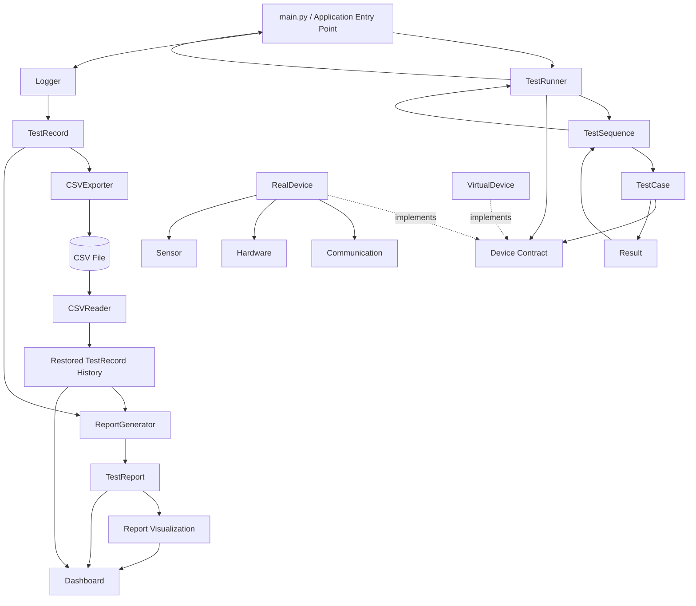
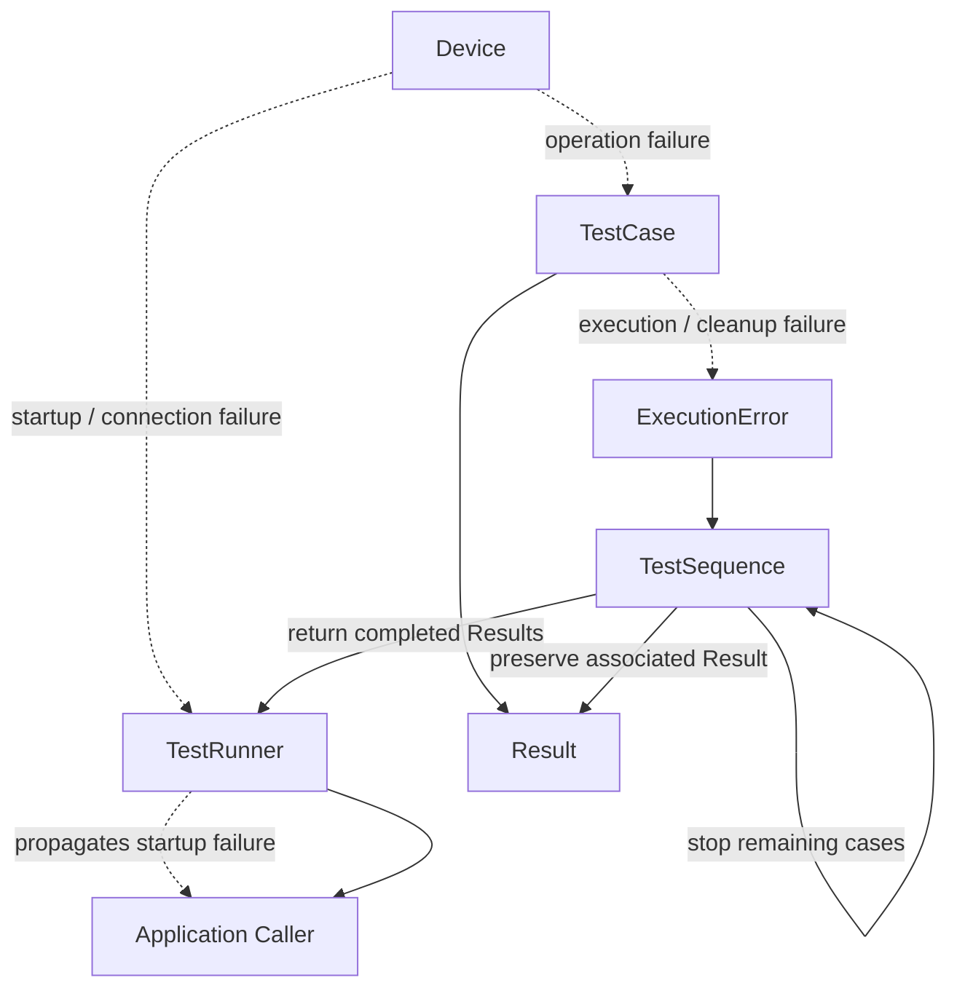

# System Architecture

---
## Objective

Build a Python-based hardware testing platform.

The system simulates an automated testing laboratory capable of:

- Controlling hardware devices
- Collecting sensor data
- Logging test results
- Performing data analysis
- Generating reports

## Core Modules

- Framework
- Controller
- Device
- Hardware
- Sensors
- Communication
- Data
- Logger
- Export
- Report
- Visualization
- Analysis
- Dashboard

## Core Responsibilities  

**TestRunner**: Manages the overall test execution lifecycle.
1. Connects to device before test execution
2. Starts test sequence
3. Ensures the device is disconnected after execution
4. Returns the collected execution results to the caller

**TestSequence**: Defines and executes the test sequence
1. Runs the individual tests in order
2. Collects and returns test results for the current execution
3. Catches `ExecutionError` raised by an individual test case and preserves the associated completed `Result`
4. Stops the remaining sequence after an execution or cleanup failure because the device state can no longer be assumed reliable
5. Returns all completed results collected before and including the failed test

**TestCase**: Defines and executes the logic of an individual test
1. Defines and performs the steps of an individual test
2. Collects measurements and determines the test outcome (`PASS`, `FAIL`, or `ERROR`)
3. Stores the test outcome and execution information in a `Result`
4. Performs case-level cleanup after test execution
5. Preserves primary execution errors separately from cleanup errors
6. Preserves an already determined `PASS` or `FAIL` outcome when only cleanup fails
7. Raises `ExecutionError` when an execution or cleanup failure requires the remaining test sequence to stop

**Device**: Defines the abstract contract that all device implementations must follow
1. Defines the minimum set of operations required by the test framework
2. Enforces that concrete device implementations provide the required methods

**RealDevice**: Provides the concrete device integration boundary for composing communication, hardware-control, and
sensor components behind the common `Device` contract
1. Receives Communication, Hardware, and Sensor dependencies during initialization
2. Implements the operations defined by the Device abstraction
3. Delegates device operations to the appropriate underlying component

**VirtualDevice**: Implements the Device contract using simulated device state and behavior
1. Maintains simulated connection, movement, and measurement state
2. Implements the same operations defined by the Device abstraction
3. Provides VirtualDevice-specific controls for deterministic measurement, connection, movement, read, and stop failure scenarios
4. Keeps simulation-specific controls outside the Device contract
5. Raises `DeviceError` for invalid device operations and simulated device failures
6. Preserves simulated device state when a configured operation fails before completing its state transition

**Result**: Stores the outcome and execution information of an individual test
1. Stores the test outcome (`PASS`, `FAIL`, or `ERROR`)
2. Stores measurement, timing information, and name of the test
3. Preserves the primary test execution error when test execution fails
4. Preserves cleanup error information separately from the primary execution error
5. Allows cleanup failure information to coexist with an already determined `PASS` or `FAIL` outcome

**TestRecord**: Represents the completed data of an individual test execution
1. Stores test name, measurement, timing, outcome, primary error, and cleanup error information
2. Assigns a unique identifier to each recorded test execution
3. Preserves completed test data as an immutable record
4. Provides a data-layer representation independent from the execution-layer `Result`

**Logger**: Records completed test result data outside the test execution framework
1. Receives completed `Result` objects after framework execution
2. Converts each completed `Result` into an independent `TestRecord`
3. Collects recorded test executions for downstream data processing
4. Keeps logging responsibilities separate from TestRunner, TestSequence, and TestCase

**CSVExporter**: Persists completed test records in CSV format
1. Receives completed `TestRecord` objects for export
2. Serializes record fields into a stable CSV representation
3. Appends new records without replacing previously exported test data
4. Writes the CSV header only when the target file does not exist or is empty
5. Preserves the input record order during export
6. Performs no file operation when no records are provided

**CSVReader**: Restores persisted test record data from CSV format
1. Reads persisted test record data from an existing CSV file
2. Deserializes CSV field values back into the data types required by `TestRecord`
3. Restores timestamps, durations, record identifiers, measurements, outcomes, primary errors, and cleanup errors
4. Preserves unavailable measurement, error, and cleanup-error values as `None`
5. Preserves valid zero measurement values separately from unavailable measurements
6. Returns completed `TestRecord` objects for downstream reporting and presentation

**ReportGenerator**: Generates structured test summaries from completed test record data
1. Receives completed `TestRecord` objects for report generation
2. Aggregates test outcomes into total, pass, fail, and error counts
3. Calculates the pass rate when test records are available
4. Calculates measurement count, minimum, maximum, and average from available measurement values
5. Excludes missing measurements from measurement statistics while preserving valid zero values
6. Collects relevant failure information from `FAIL` and `ERROR` records
7. Rejects records with unsupported test outcomes
8. Produces a `TestReport` without modifying the source test records

**TestReport**: Represents aggregated report data derived from completed test records
1. Stores total test, pass, fail, and error counts
2. Stores the calculated pass rate, or no pass rate when no tests are available
3. Stores measurement count, minimum, maximum, and average statistics
4. Represents unavailable measurement statistics explicitly when no valid measurements exist
5. Stores summarized failure details for `FAIL` and `ERROR` test records
6. Contains report data only and performs no report calculation

**ReportVisualization**: Converts structured test report data into visual representations
1. Receives a completed `TestReport` as visualization input
2. Visualizes PASS, FAIL, and ERROR distribution as a pie chart
3. Visualizes minimum, average, and maximum measurement statistics as a bar chart
4. Displays measurement count as supplementary visualization context
5. Represents empty test and measurement data explicitly instead of producing ambiguous empty charts
6. Returns the generated Figure and Axes without controlling how the visualization is displayed
7. Performs no report calculation and relies on the statistics already provided by `TestReport`

**Dashboard**: Presents persisted test report and record data through an interactive user-facing interface
1. Loads persisted test history through `CSVReader`
2. Generates the overall `TestReport` from the restored historical `TestRecord` data through `ReportGenerator`
3. Displays total test count, pass rate, and PASS, FAIL, and ERROR counts
4. Reuses existing report visualization functions for outcome and measurement charts
5. Displays summarized failure information from the generated `TestReport`
6. Displays individual test history from restored `TestRecord` data
7. Supports basic outcome-based filtering of displayed test history
8. Represents missing persisted data, unavailable statistics, and empty presentation states explicitly
9. Performs no report calculation itself and does not modify source report or record data
10. Remains independent from test execution and logging responsibilities

**ExecutionError**: Represents a test-case execution or cleanup failure that requires sequence-level handling
1. Preserves the original exception together with test context
2. Carries the associated `Result`, failure stage, and timestamp
3. Preserves a secondary cleanup error when both test execution and cleanup fail
4. Transfers failure context from `TestCase` to `TestSequence`
5. Allows `TestSequence` to preserve the associated completed result and stop the remaining sequence without discarding collected execution evidence

**DeviceError**: Represents device-level operation failures
1. Belongs to the Device abstraction layer
2. Can be raised by concrete device implementations when an operation is invalid or cannot be completed
3. Keeps device-level failures independent from framework-level `ExecutionError`

## Application Orchestration

The project entry point in `main.py` owns the top-level execution orchestration for the current MVP. It configures the
device and test sequence, starts execution through `TestRunner`, passes completed execution results to `Logger`, and
passes the resulting `TestRecord` data to downstream persistence and reporting components.

The entry point coordinates existing components without taking over their internal responsibilities. Test execution,
result-to-record conversion, CSV serialization, and report calculation remain owned by their respective components.
A separate application-service layer is not introduced because the current MVP orchestration does not yet require an
additional abstraction.

## Core Execution and Data Flow

The following diagram shows the direct interactions and data flow between the core components during and after test
execution.

Solid arrows represent direct runtime interaction or data flow between components.
Dashed arrows represent implementation of an abstraction contract.

Each TestCase produces a Result for its execution. TestSequence collects the Results produced during the current
execution and returns them through TestRunner to the caller. Execution results are scoped to a single run and are not
stored as persistent state in TestSequence. The caller can pass completed Results to the Logger after execution, keeping
result logging outside the test execution framework. The Logger converts each completed Result into an immutable
TestRecord with its own record identity, providing a data-layer representation for downstream data processing.

When an individual `TestCase` raises `ExecutionError`, `TestSequence` preserves the completed `Result` carried by the
exception and stops the remaining test cases. Results completed before the failure and the failed test's completed result
remain available to the caller as execution evidence. The preserved result may contain an `ERROR` outcome for an
execution failure or retain an already determined `PASS` or `FAIL` outcome when only cleanup fails.

Startup failures that occur before individual test execution, such as device connection failure, remain execution-level
failures and do not produce `Result` or `TestRecord` data because no test case has completed. These failures continue to
propagate to the application caller.

Completed TestRecord data can be consumed independently by downstream components. CSVExporter persists TestRecord data
into CSV format while preserving existing test history, record order, and a stable serialization format. ReportGenerator
aggregates completed TestRecord data into a TestReport containing outcome counts, pass rate, measurement statistics, and
failure details. Reporting operates on the data-layer TestRecord representation and remains independent from the
execution-layer Result representation and CSV persistence format.

Persisted CSV data can be restored through `CSVReader` for downstream consumers that run independently from the main
test execution process. `CSVReader` reconstructs persisted CSV fields into completed `TestRecord` objects, including
timestamps, durations, identifiers, measurements, outcomes, and error information. Missing optional values are restored
as unavailable values while valid zero measurements remain distinct from missing measurements.

TestReport data can be consumed by the visualization layer to produce presentation-oriented representations without
recalculating report statistics. Report visualization converts outcome counts into a pie chart and measurement summary
statistics into a bar chart, while representing empty data states explicitly. Generated Figure and Axes objects are
returned to the caller so display and downstream presentation remain outside the visualization functions.

The dashboard uses the persisted CSV file as its runtime data boundary rather than depending directly on the test
execution process. Persisted test history is restored through `CSVReader`, and the restored `TestRecord` collection is
passed to `ReportGenerator` to produce the `TestReport` used for overall summary information and visualization. The same
restored records provide individual test history and filtering data.

This persistence boundary keeps the Streamlit dashboard independent from `TestRunner`, `TestSequence`, `TestCase`, and
`Logger`. The dashboard can therefore run as a separate process without triggering test execution. When no persisted CSV
data is available, the dashboard represents the missing-data state explicitly and uses the existing empty-report behavior
rather than failing during startup.

Dashboard filtering remains limited to the displayed test history. Filtering does not modify the overall historical
`TestReport` summary or visualization data. This keeps report calculation centralized in `ReportGenerator` while allowing
the dashboard to provide lightweight interactive inspection of persisted test records.

## Error Handling Flow

