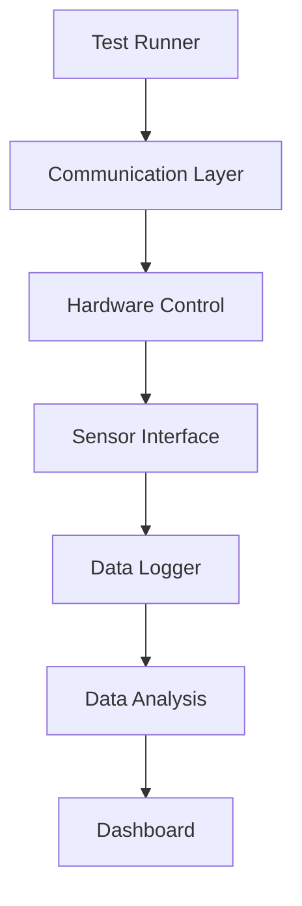

# System Architecture

---
## Objective

Build a Python-based hardware testing platform.

The system simulates an automated testing laboratory capable of:

- Controlling hardware devices
- Collecting sensor data
- Logging test results
- Performing data analysis
- Generating reports

## Core Modules

- Controller
- Hardware
- Sensors
- Communication
- Logger
- Analysis
- Dashboard

---
## Work Flow

