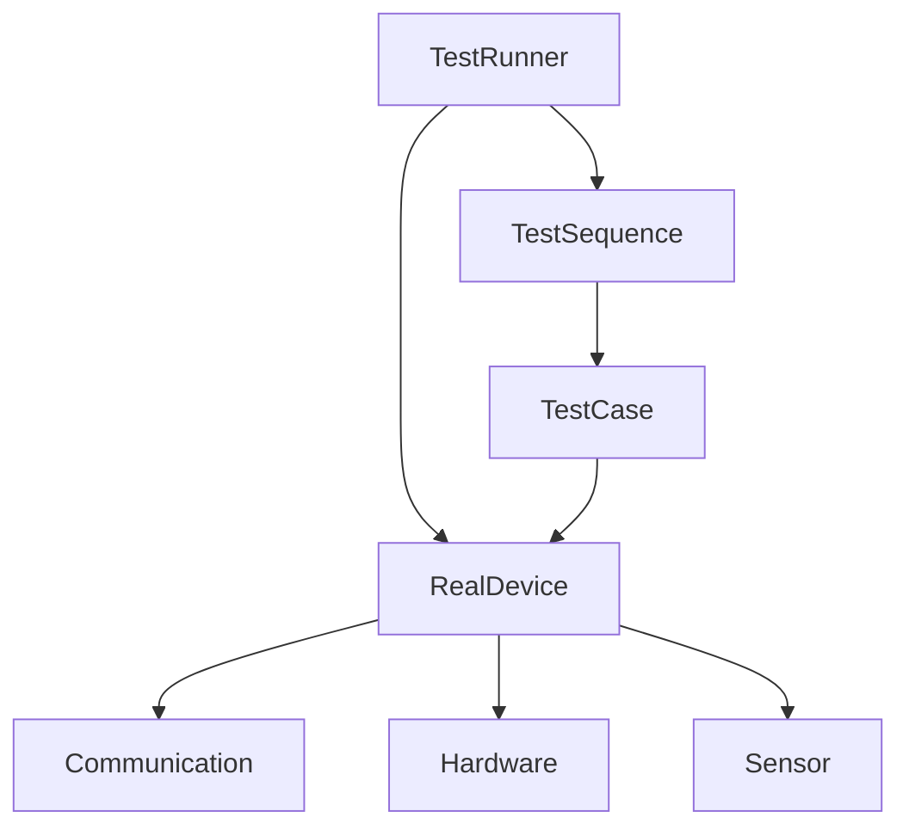
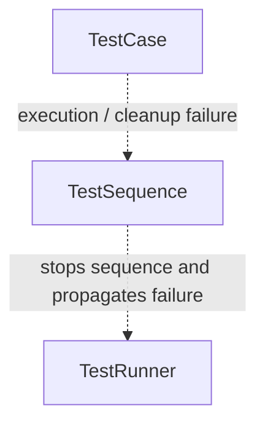

# System Architecture

---
## Objective

Build a Python-based hardware testing platform.

The system simulates an automated testing laboratory capable of:

- Controlling hardware devices
- Collecting sensor data
- Logging test results
- Performing data analysis
- Generating reports

## Core Modules

- Framework
- Controller
- Device
- Hardware
- Sensors
- Communication
- Logger
- Analysis
- Dashboard

## Core Responsibilities  

**TestRunner**: Manages the overall test execution lifecycle.
1. Connect to device before test execution
2. Starts test sequence
3. Ensure the device is disconnect after execution

**TestSequence**: Defines and executes the test sequence  
1. Run the individual tests in order
2. Collects and stores test results
3. Stops the remaining sequence and propagates `ExecutionErro ` when and execution-level failure occurs

**TestCase**: Defines and executes the logic of an individual test
1. Defines and perform the steps of an individual test
2. Collects measurements and determines the test outcome (`PASS`, `FAIL`, or `ERROR`)
3. Stores the test outcome and execution information in a `Result` 
4. Performs case-level cleanup after test execution
5. Raises `ExecutionError` when an execution-level failure requires the test sequence to stop

**Device**: Defines the abstract contract that all device implementations must follow
1. Defines the minimum set of operations required by the test framework
2. Enforces that concrete device implementations provide the required methods

**RealDevice**: Implements the Device contract using the real hardware components
1. Receives Communication, Hardware, and Sensor dependencies during initialization
2. Implements the operations defined by the Device abstraction
3. Delegates device operations to the appropriate underlying component

**Result**: Stores the outcome and execution information of an individual test
1. Stores the test outcome (`PASS`, `FAIL`, or `ERROR`)
2. Stores measurement, timing information, and name of the test 
3. Preserves test-level error information when test execution fails

**ExecutionError**: Represents an execution-level failure that must be propagated through the framework 
1. Preserves the original exception together with test context. 
2. Carries the associated result, failure stage, and timestamp. 
3. Preserves a secondary cleanup error when both execution and cleanup fail. 
4. Propagates the failure upward so the remaining test sequence can be stopped.

## Core Execution Flow

The following diagram shows the direct interactions between the core components during test execution. An arrow indicates that one component directly invokes another component.

## Error Handling Flow

